<div align="center">



# dotfiles

**One command sets up a Mac, Debian or Ubuntu for coding with Claude Code, Cursor and Opencode.**

</div>

## Set up a Mac

1. Open the **Terminal** app. Do not use a Claude Code window for this.
2. Paste this line, then press Enter:

   ```sh
   sh -c "$(curl -fsSL https://raw.githubusercontent.com/pavstev/dotfiles/main/bootstrap.sh)"
   ```

3. Type your Mac password when it asks. Homebrew needs it.
4. Answer the questions. Use ↑ ↓ to move and Enter to pick.
   - 👤 your name and ✉️ your email, for git commits
   - ⚙️ the settings menu: Java, private rules, private words and more. Pick ✅ Done to
     keep the defaults.
   - ✨ an optional extra: the Claude desktop app
5. Wait. The first run takes about 20 to 40 minutes.
6. 🔑 Pick what to sign in to: GitHub, Claude Code, Opencode, Cursor. A browser opens for each one.
7. Open a new Terminal window.

## Set up Linux

This works on Debian 13 and Ubuntu 24.04, on x86_64 and arm64. You need a normal user
that can run `sudo`.

1. Open a terminal.
2. Paste this line, then press Enter:

   ```sh
   bash -c "$(curl -fsSL https://raw.githubusercontent.com/pavstev/dotfiles/main/bootstrap.sh)"
   ```

   No `curl` yet? Run `sudo apt-get install -y curl` first.
3. Type your password when it asks. `apt` and Homebrew need it.
4. Answer the questions, as in steps 4 to 6 of the Mac setup.
5. Open a new terminal, or run `exec zsh`.

## Set up Windows

This works in Git Bash (MSYS/MINGW). You need `git`, `curl` and `python3` on PATH
(install them via WinGet if missing).

1. Open a Git Bash terminal.
2. Paste this line, then press Enter:

   ```sh
   bash -c "$(curl -fsSL https://raw.githubusercontent.com/pavstev/dotfiles/main/bootstrap.sh)"
   ```

3. Answer the questions (git name/email, then the settings menu). Pick ✅ Done to keep the defaults.
4. Wait. The first run installs Opencode via WinGet and links your config files.
5. Open a new Git Bash window, or run: `exec zsh`

What is different from a Mac:

- No Homebrew on Windows. Opencode comes from WinGet (`winget install Anomaly.OpenCode`); the
  other Brewfile tools are not installed — add the ones you want manually.
- VS Code and Cursor settings link to `%APPDATA%\{Code,Cursor}\User\`, where the apps read them.
- Three steps are macOS only and skip with one line: macOS defaults, Touch ID for sudo, Apple
  Terminal appearance. The Claude desktop app offer, AeroSpace and the Nerd Font are Mac-only too.
- `scripts/agent-config` generates the Opencode/Claude/Cursor config. It runs the Rust build in
  `rust/agent-config` (built on first use when `cargo` is installed), so Python is not needed
  there. With no `cargo` it falls back to `python3` (install it via WinGet) or the steps warn and skip.

## Check that it works

- **Claude Code:** run `claude`, then type `/ps:`. You see the `ps:` skills.
- **Opencode:** run `opencode`, then type `/ps:`. You see the same skills.
- **Cursor:** open Cursor, open the chat, then type `/ps:`. You see the same skills.
- **Git:** run `git config user.name`. You see your name.

## Every day

- Run `dots` to get the newest setup. You can run it at any time.
- Edit the files in `~/dotfiles/home/`. Your machine uses the change at once.
- Run `dots settings` to change a setting: git name, Java, private rules and more. The
  settings stay on this machine, never in git. `settings.example` lists them all.
- Do not edit `~/.claude/CLAUDE.md`: it comes from this repo, and `dots` updates it.

## More

- [Full guide](docs/guide.md): what is inside, shortcuts, how to change things, uninstall, fixes.
- [AGENTS.md](AGENTS.md): how AI agents work on this repo, and the `owner` and `shared` profiles.
- [Cursor details](docs/cursor-port.md) and [Opencode details](docs/opencode-port.md).
- On a fork: change `DOTFILES_REPO` at the top of [`bootstrap.sh`](bootstrap.sh) and the URL in step 2.

## License

[MIT](LICENSE)
